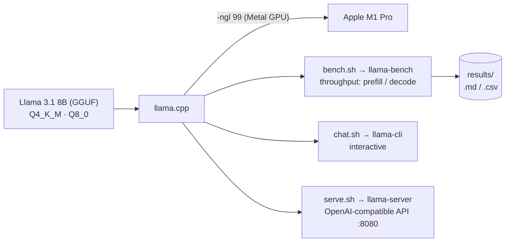

# Edge AI Client — Local Llama 3.1 8B on Apple Silicon

Running an 8-billion-parameter LLM entirely **on-device** — no cloud API, no per-token
cost, no data leaving the machine — and measuring the real engineering tradeoff that
makes it practical: **quantization**.

> **Why a client would care:** sending customer data to a cloud LLM is often a
> compliance, cost, or latency non-starter. This project shows a working path to run a
> capable model locally on hardware a team already owns, and quantifies exactly what you
> give up (quality) and gain (memory, speed) at each precision level.

---

## The setup

| Component        | Choice                                   |
| ---------------- | ---------------------------------------- |
| Hardware         | MacBook Pro · Apple M1 Pro · 16 GB RAM   |
| Inference engine | [llama.cpp](https://github.com/ggml-org/llama.cpp) (build 12119) |
| Acceleration     | Apple Metal (GPU)                        |
| Model            | Meta Llama 3.1 8B Instruct               |
| Format           | GGUF                                     |
| Precisions       | Q4_K_M (primary) vs Q8_0 (quality reference) |

**Memory reality on a 16 GB Mac:** the model weights are only part of the footprint —
macOS, the runtime, the context window, and the KV cache all consume RAM too. That's why
`Q4_K_M` (~4.9 GB) is the practical daily-driver target, with `Q8_0` (~8.5 GB) used as a
higher-precision reference to measure quality loss against.

---

## How it fits together



The same local server (`serve.sh`) is what the sibling
[`local-document-assistant`](../local-document-assistant) RAG app calls for answer generation.

---

## Project layout

```
edge-ai-client/
├── bin/           # thin wrappers around the llama.cpp tools (on any PATH)
├── models/        # GGUF model files (git-ignored — large)
├── vendor/        # llama.cpp prebuilt macOS arm64 binaries (git-ignored)
├── benchmarks/    # bench.sh — throughput measurement harness
├── src/           # chat.sh (interactive) · serve.sh (OpenAI-compatible API)
├── results/       # benchmark output (.md / .csv)
└── docs/          # case study writeup
```

## Quick start

```bash
# 1. Interactive chat (defaults to the Q4_K_M model)
./src/chat.sh

# 2. Benchmark a model's throughput
./benchmarks/bench.sh models/Meta-Llama-3.1-8B-Instruct-Q4_K_M.gguf q4_k_m

# 3. Serve it as a local, OpenAI-compatible API
./src/serve.sh
#   -> POST http://localhost:8080/v1/chat/completions
```

## Hardware & platforms

This case study was **measured on Apple Silicon (M1 Pro, Metal)** — so the throughput
numbers below are specific to that machine. The **approach is cross-platform**, though:
llama.cpp runs on macOS, Linux, and Windows across CPU, NVIDIA (CUDA), AMD (ROCm/Vulkan),
and Apple (Metal). Pick the matching prebuilt binary and the same commands work; re-run
`benchmarks/bench.sh` to get numbers for *your* hardware.

**Minimum to run Llama 3.1 8B locally:**

| Precision | File size | Recommended free RAM (CPU) or VRAM (GPU) |
| --------- | --------- | ---------------------------------------- |
| Q4_K_M    | ~4.9 GB   | **≥ 8 GB** (model + context + KV cache)  |
| Q8_0      | ~8.5 GB   | **≥ 12 GB**                              |

**Which llama.cpp build to download** (from the [releases page](https://github.com/ggml-org/llama.cpp/releases)):

| Platform / accelerator      | Release asset pattern            | Notes |
| --------------------------- | -------------------------------- | ----- |
| macOS Apple Silicon (Metal) | `…-bin-macos-arm64.tar.gz`       | what this repo used |
| macOS Intel                 | `…-bin-macos-x64.tar.gz`         | CPU |
| Linux, NVIDIA GPU           | `…-bin-ubuntu-cuda-*.zip` (or build with `-DGGML_CUDA=ON`) | needs CUDA |
| Linux, CPU                  | `…-bin-ubuntu-x64.zip`           | any x86-64 |
| Windows, NVIDIA GPU         | `…-bin-win-cuda-*.zip`           | needs CUDA |
| Windows, CPU                | `…-bin-win-avx2-x64.zip`         | |

## Reproducing from scratch

The binaries and models aren't committed (too large). Rebuild the environment:

```bash
# 1. llama.cpp binaries — pick the asset for YOUR platform from the table above.
#    macOS arm64 example (what this repo used):
curl -L -o vendor/llama.tar.gz \
  https://github.com/ggml-org/llama.cpp/releases/download/b12119/llama-b12119-bin-macos-arm64.tar.gz
mkdir -p vendor/llama-b12119 && tar -xzf vendor/llama.tar.gz -C vendor/llama-b12119
#    macOS ONLY — clear Gatekeeper quarantine on the downloaded binaries:
xattr -dr com.apple.quarantine vendor/llama-b12119

# 2. model (ungated GGUF redistribution) — same on every platform:
curl -L -o models/Meta-Llama-3.1-8B-Instruct-Q4_K_M.gguf \
  https://huggingface.co/bartowski/Meta-Llama-3.1-8B-Instruct-GGUF/resolve/main/Meta-Llama-3.1-8B-Instruct-Q4_K_M.gguf
```

> **Note:** the `bin/` wrapper scripts and `src/*.sh` are bash and were written for macOS.
> On Linux they work as-is once `vendor/` holds the Linux binaries; on Windows use WSL, or
> call the llama.cpp executables (`llama-cli`, `llama-bench`, `llama-server`) directly with
> the same flags. GPU offload is `-ngl 99` on any backend (Metal/CUDA/ROCm).

---

## Results

Full writeup in [`docs/case-study.md`](docs/case-study.md). Raw benchmark output is in
[`results/`](results/) (`.csv` = source of truth, `.md` = readable table).

Measured on Apple M1 Pro / 16 GB, Metal (`-ngl 99`), `llama-bench`, 5 reps, pp512 / tg128:

| Precision | Size on disk | Prefill (pp512, tok/s) | Decode (tg128, tok/s) | Role |
| --------- | ------------ | ---------------------- | --------------------- | ---- |
| Q4_K_M    | 4.58 GiB     | **204 ± 20**           | **24.4 ± 0.4**        | daily driver |
| Q8_0      | 7.95 GiB     | 103 ± 20               | 14.9 ± 0.8            | quality reference |

**Q4_K_M is ~2.0× faster at prefill and ~1.6× faster at decode than Q8_0, and 42% smaller
on disk** — the expected quantization tradeoff, and the reason Q4_K_M is the performance and
memory default on 16 GB. A side-by-side *output-quality* comparison was planned but deferred
(see the case study's "Thermal behavior" note), so Q4_K_M is the default *pending* quality
evaluation.

---

## What this demonstrates

- Standing up a local inference stack on consumer hardware with GPU acceleration
- Understanding and measuring the quantization quality/memory/speed tradeoff
- Serving a local model behind an OpenAI-compatible API (drop-in for existing code)
- Reproducible benchmarking and honest reporting of hardware-constrained results

## License notes

Llama 3.1 is used under the [Llama 3.1 Community License](https://www.llama.com/llama3_1/license/).
llama.cpp is MIT-licensed.
